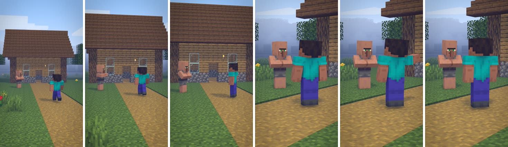

# Minecraft engine (Remotion + three.js)

The voxel renderer behind the Minecraft shorts on [RubyBlocked](https://www.youtube.com/@RubyBlocked): blocks, mobs,
acting, cameras, water/lava, particles and the post look, all drawn with three.js inside [Remotion](https://www.remotion.dev/).
No game client runs while rendering, and there's no screen recording.

**There are no Minecraft textures in this folder, and there never will be.** The block, mob and item pictures belong to
Mojang. You extract them yourself from **your own copy of Minecraft Java Edition** with `tools/mc_extract.py`. They stay on
your PC (`mc-assets/` and `public/mc-preview/` are git-ignored). Don't commit or share them.



## What you need

- **Minecraft Java Edition** installed, with the version you want launched at least once so its client `.jar` exists.
  The jar lives in `versions/<version>/<version>.jar` inside your game folder:
  - Windows: `%APPDATA%\.minecraft\versions\`
  - macOS: `~/Library/Application Support/minecraft/versions/`
  - Linux: `~/.minecraft/versions/`
- **Node 24+**: the CLI runs `.ts` files directly.
- **Python 3.10+** with `Pillow` (texture extraction) and `numpy` (the keying gate): `pip install pillow numpy`.
- A GPU is strongly recommended. `remotion.config.ts` renders with ANGLE, which is about 20x faster than software GL.

## Quick start

```bash
cd engines/minecraft
npm install

# 1. textures from YOUR game (reads the jar, writes mc-assets/; never downloads anything)
python -I tools/mc_extract.py --jar "%APPDATA%\.minecraft\versions\1.21.5\1.21.5.jar"     # Windows
python -I tools/mc_extract.py --jar ~/.minecraft/versions/1.21.5/1.21.5.jar              # Linux

# 2. the demo: a village yard set, two shots, a silent voice track
python demo/build_demo.py

# 3. look at it
npx remotion studio src/index.ts                                  # composition McDemo
npx remotion render src/index.ts McDemo out/demo.mp4
```

If a frame is all black, the post-processing packages were upgraded: keep the exact versions in `package.json`
(`@react-three/postprocessing` 3.0.4 with `n8ao` 1.10.3). Newer ones render black.

## How a short is built

| Piece | File | Made by |
|---|---|---|
| A set (the world) | `<set>.voxel.json`: palette + ops (`fill`, `hollow`, `walls`, `block`, `replace`), sky, mobs, props, named cameras | you / the `world` agent; schema in `src/director/schema/minecraft.ts` |
| Staged set | `public/mc-preview/<story>/<set>/world.json` + only the textures that set uses | `npm run mc -- mc-stage <set>.voxel.json --out public/mc-preview/<story>/<set>` |
| Timeline | `public/mc-preview/<story>/short/plan.json`: shots with frames and the set each one uses (30 fps) | your build script |
| Direction | `.../short/direction.json`: per shot camera keys, mob keys (`at`, `facing`), acts (`wave`, `talk`, `point`, `nod`, ... 70+ kinds), effects | your build script / the keying agents |
| Voice | `.../short/voice.wav` | your VO (McShort needs one; the demo writes a silent one) |
| Composition | one `<Composition component={McShort} ...>` per story in `src/Root.tsx` | you |

`demo/build_demo.py` is a complete small example of all of the above. Start a new story by copying it.

Other tools:

- `npm run mc -- mc-validate <file|dir>`: check sets against your manifest (unknown blocks, mobs inside blocks, size).
- `npm run mc -- mc-preview <set>.voxel.json`: stage the set and render one still per named camera to `out/mc-preview/`.
- `python scripts/mc_fx_textures.py`: stage the shared effect textures (cracks, smoke, splashes, explosions, raid props).
  `demo/build_demo.py` runs it for you.
- `python scripts/mccheck/mcq.py gate <story>/short <shots> -v`: the staging gate. It checks the numbers for cameras inside
  blocks, floating feet, clipping, head cuts and the Shorts safe zone, with no render. Run it before every still.
  `mcq.py` also answers keying questions (`words`, `at`, `keys`, `acts`, `set`, `ground`). See `scripts/mccheck/README.md`.
- `python scripts/mccheck/check/plant_test.py`: the gate's own regression test (needs the demo built first).

With Claude Code, the [`minecraft-story`](../../skills/minecraft-story) skill's **jalur R** drives all of this: VO lock,
one-world shotlist, parallel build agents, per-section keying with the gate, review, sound, and the final 2K 60 fps render.
The [`cartoon-3d-short`](../../skills/cartoon-3d-short) skill's Minecraft mode uses the same engine.

## Game versions

Tested with 1.21.5 (a fresh extract) and 26.4 snapshots (the shorts on the channel). Block, mob and item names are
checked against *your* manifest, so a set that names a block your version doesn't have fails validation and tells you
which one. A few textures moved between versions; the stagers try the older names (`ALIASES` in
`src/director/minecraft/compile.ts` and `scripts/mc_fx_textures.py`). Add a line there if you find another.

## Folder map

```
src/minecraft/            the renderer: McShort (whole short), McPreview (one still), VoxelWorld, Actors, mobs/ (models,
                          rigs, 70+ acts), Fluids, Weather, effects, McPost (look: AO, bloom, grade, grain)
src/director/             voxel-set schema, validator and stager (mc.ts is the CLI)
src/videos/court|alfatih  post effects McPost uses (lens blur, grain, colour grade)
tools/mc_extract.py       texture + block model extractor (your jar -> mc-assets/manifest.json)
scripts/                  fx texture stager, mccheck keying toolkit
demo/                     build_demo.py + a small sky island set (cg-a-i0) the gate's plant test uses
```

## What is in here, legally

All code here is MIT (see the repo `LICENSE`). Mob shapes and acting are written in code: box sizes and joints, no image
data. `src/minecraft/redstoneModels.ts` inlines the box coordinates of three vanilla block models (piston, piston head,
repeater) as numbers. No PNG, sound or other game file is included. Minecraft is a trademark of Mojang Synergies AB, and
this project is not affiliated with Mojang or Microsoft.

## Bahasa Indonesia (ringkas)

Engine ini **tidak membawa tekstur Minecraft**. Ekstrak sendiri dari Minecraft Java milikmu:
`python -I tools/mc_extract.py --jar <file .jar versi game>`. Hasilnya `mc-assets/` dan `public/mc-preview/` hanya di PC-mu
(sudah masuk `.gitignore`), jangan di-commit atau dibagikan. Lalu jalankan `npm install`, `python demo/build_demo.py`,
dan `npx remotion render src/index.ts McDemo out/demo.mp4`. Kalau gambarnya hitam semua, kembalikan versi paket ke yang
tertulis di `package.json`.
